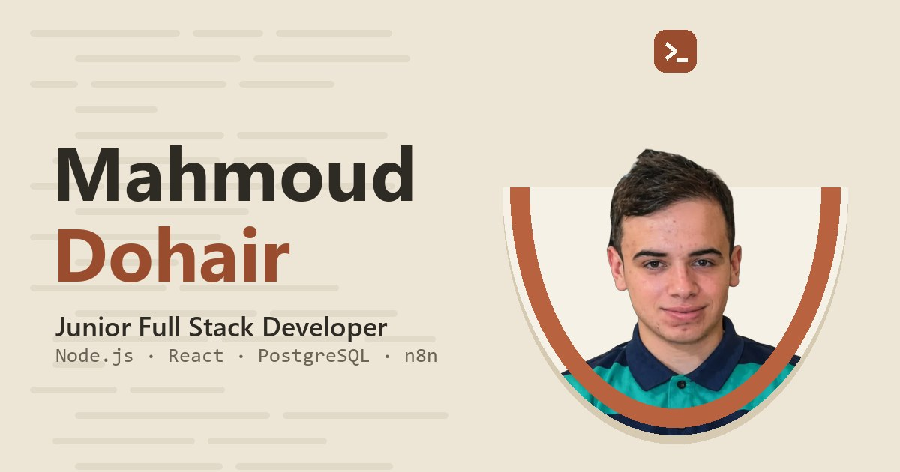

<div align="center">



# Mahmoud Dohair — Portfolio

**Junior Full Stack Developer · Workflow Automation**

[**Live site → mahmoud-dohair.netlify.app**](https://mahmoud-dohair.netlify.app/)


</div>

---

## Overview

My personal portfolio: who I am, the projects I've built, my learning journey, and how to reach me.
It is designed in the visual identity of **نبني (Nabni)**, my YouTube channel.

## Features

- **Bilingual:** Arabic (RTL) and English (LTR), switched with one button.
- **Light and dark modes:** your choice is remembered, and the page loads in the right theme with no flash.
- **Motion with restraint:** animated intro, scroll reveals, magnetic buttons and a custom cursor. These turn off for touch devices and for anyone with reduced motion enabled.
- **One data file:** all content (projects, skills, journey, links) lives in `src/data/profile.js`.
- **Accessible and SEO-ready:** semantic sections, keyboard navigation, ARIA labels, Open Graph tags and JSON-LD.
- **Light bundle:** React and Motion are split into their own chunks, and the brand icons are tree-shaken.

## Tech stack

| Area | Tools |
| --- | --- |
| UI | React 19, plain CSS with design tokens |
| Animation | Motion (`motion/react`) |
| Icons | Simple Icons, plus custom Nabni-style glyphs |
| Build | Vite 6 |
| Hosting | Netlify |

## Project structure

```
src/
├── components/   # Hero, About, Skills, Projects, Sections (Journey, Services, Contact), Footer, Chrome (nav, intro, cursor)
├── data/         # profile.js (all content) · ui.js (interface text, AR/EN)
├── lib/          # icons, motion helpers, language/theme preferences
└── styles/       # tokens.css · global.css · layout.css · sections.css
public/
├── images/       # photo and social preview image
└── files/        # CV (PDF)
```

## Run locally

```bash
npm install
```

```bash
npm run dev
```

```bash
npm run build
```

The production build goes to `dist/`.

## Editing content

| What | Where |
| --- | --- |
| Name, intro, photo, CV | `src/data/profile.js` → `person` |
| Email, WhatsApp, Instagram, Telegram, form endpoint | `src/data/profile.js` → `contact` |
| Social platforms (an empty `url` hides it) | `src/data/profile.js` → `socials` |
| Skills, projects, journey, services, stats | `src/data/profile.js` |
| Interface text | `src/data/ui.js` |
| Colours, fonts, radii | `src/styles/tokens.css` |

**Contact form:** while `contact.formEndpoint` is empty, the form opens the visitor's email app with the message filled in. To receive messages directly, paste a [Formspree](https://formspree.io) endpoint there.

## Design notes

The design follows the Nabni identity rules:
- depth comes from solid layers, with no blur, glow or gradients;
- clay is the only accent colour;
- the fonts are Sora, Alexandria and JetBrains Mono;
- code lines are the only decorative pattern.

The dark mode is built from the identity's own code-window colours.

## Contact

- Email: [mdohair22@gmail.com](mailto:mdohair22@gmail.com)
- GitHub: [@mamdsm-scfd](https://github.com/mamdsm-scfd)
- YouTube: [@nabni28](https://www.youtube.com/@nabni28)

---

© Mahmoud Dohair. All rights reserved. The code is public to read and learn from. The photo, CV and the Nabni identity are personal and not for reuse.
